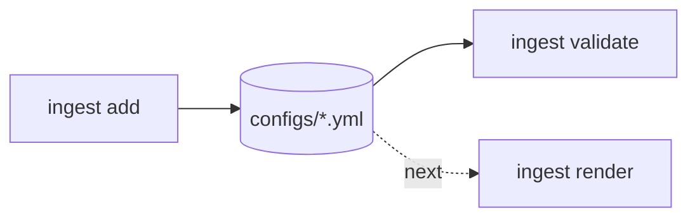

# ingestion-toolkit

> A command line tool that writes validated YAML or JSON ingestion configs, one per source table, for relational sources.


## What this demonstrates

- Config as a contract: frozen, typed Pydantic models with explicit validators. Every error names the file, the field and a fix.
- Two ingestion patterns as data: full scan and incremental (watermark), with the write mode derived from the pattern, an optional column contract and a tolerated reject ratio.
- Deterministic output: the same command writes the same bytes, and a test rebuilds the files in `examples/` from the documented commands.
- Property-based tests (Hypothesis) for naming, cron validation, the column spec and the model round trip, on top of CLI tests.
- A typed, src-layout package built with uv, checked with ruff and strict mypy.

Roadmap: rendering Airflow 3 DAG files from these configs, a change data capture pattern, and a docker compose demo.

## How it works



`ingest add` builds a config from command line options, validates it and writes it. `ingest validate` checks files or directories and reports every problem it finds. Rendering is the next step and is not part of this release.

## Tech stack

Python 3.11+, Typer, Pydantic v2, PyYAML, uv, pytest, Hypothesis, ruff, mypy.

## Quickstart

```bash
uv sync
uv run ingest add rdbms fullscan \
  --source erp --database erp --schema sales --table orders --primary-key id \
  --columns "id:integer!,customer_id:integer,product_id:integer,quantity:integer,total:numeric,order_date:date" \
  --max-reject-ratio 0.01
uv run ingest validate examples
```

The `add` command writes `configs/erp__orders__fullscan.yml`:

<!-- example:start -->
```yaml
version: 1
source:
  name: erp
  source_type: rdbms
  connection_id: erp
  database: erp
  schema_name: sales
extract:
  table: orders
  primary_key:
    - id
  pattern: fullscan
  columns:
    - name: id
      type: integer
      nullable: false
    - name: customer_id
      type: integer
      nullable: true
    - name: product_id
      type: integer
      nullable: true
    - name: quantity
      type: integer
      nullable: true
    - name: total
      type: numeric
      nullable: true
    - name: order_date
      type: date
      nullable: true
load:
  connection_id: warehouse
  target_schema: bronze
  target_table: erp__orders
  write_mode: overwrite
  max_reject_ratio: 0.01
landing:
  root: /opt/airflow/data/landing
schedule:
  cron: '@daily'
  start_date: 2026-01-01
  retries: 3
  retry_delay_minutes: 5
  tags: []
metadata:
  owner: data-engineering
```
<!-- example:end -->

An incremental config adds a watermark. `examples/postgres/erp__customers__incremental.yml` comes from:

```bash
uv run ingest add rdbms incremental \
  --source erp --database erp --schema sales --table customers --primary-key id \
  --columns "id:integer!,name:text,email:text,city:text,created_at:timestamp,updated_at:timestamp" \
  --watermark-column updated_at --watermark-type datetime
```

Add `--format json` for JSON, `--output-dir` to choose the folder and `--force` to overwrite an existing file. Run `uv run ingest add rdbms fullscan --help` for every option.

Errors go to stderr, one line each, followed by a summary:

```text
error: configs/erp__orders__fullscan.yml: load.max_reject_ratio: max_reject_ratio is 2.0, allowed 0 to 1. Fix: use a value from 0 to 1
0 valid, 1 invalid
```

Exit codes: 0 when everything is valid, 1 for an invalid config or a refused overwrite, 2 for a usage error.

## Config reference

The file name must be `{source}__{table}__{pattern}` in lowercase, for example `erp__orders__fullscan.yml`. Unknown fields are rejected, and so are duplicate YAML keys. An optional section (`load`, `landing`, `schedule`, `metadata`) that is missing or null takes its defaults; to run a DAG only when triggered, set `schedule.cron: null` instead.

| Section | Field | Default | Notes |
| --- | --- | --- | --- |
| root | version | required | Must be 1 |
| source | name | required | Lowercase segment: letters, digits, single underscores |
| source | source_type | rdbms | rdbms or mssql |
| source | connection_id | the source name | Airflow connection id |
| source | database | required | Identifier |
| source | schema_name | public (dbo for mssql) | Identifier |
| extract | table | required | Identifier; lowercased it must be a valid segment |
| extract | primary_key | required | A name or a list, unique, at least one |
| extract | pattern | required | fullscan or incremental |
| extract | columns | none | Data contract: name, type, nullable. Without it the extract reads all columns |
| extract | watermark | none | Required for incremental, forbidden for fullscan: column, type, initial_value |
| load | connection_id | warehouse | Target connection id |
| load | target_schema | bronze | Identifier |
| load | target_table | source__table | At most 59 characters |
| load | write_mode | from the pattern | fullscan: overwrite (or append). incremental: append (or merge) |
| load | max_reject_ratio | 0.0 | From 0 to 1 |
| landing | root | /opt/airflow/data/landing | Non-empty path |
| schedule | cron | @daily | null, a preset, or five cron fields |
| schedule | start_date | 2026-01-01 | A fixed default keeps files deterministic |
| schedule | retries | 3 | 0 to 10 |
| schedule | retry_delay_minutes | 5 | 1 to 1440 |
| schedule | tags | [] | Each 1 to 100 characters |
| metadata | owner | data-engineering | Non-empty |
| metadata | description | none | Free text |

Column types are integer, numeric, float, boolean, text, date, timestamp and timestamptz. Column names cannot start with `_ingest_` and cannot repeat.

With a column contract, the primary key and the watermark column must be listed in it. Primary key columns are stored as not null. A datetime watermark needs a timestamp, timestamptz or date column, and an integer watermark needs an integer column. The initial value must be an ISO datetime or an integer to match the watermark type. It is stored as text in one canonical form: an ISO datetime such as 2026-01-01T00:00:00, or an integer such as 5 (so 5, +05 and '5' are the same value). Columns and key names cannot start with `_ingest_`, including the primary key and the watermark column.

Presets for cron are @once, @hourly, @daily, @weekly, @monthly, @quarterly and @yearly. Five-field expressions accept ranges, steps, lists, and month and weekday names.

## Project structure

```text
src/ingestion_toolkit/
  cli/            main, add, validate and shared error output
  models/         enums and the frozen config models
  config_io.py    read, validate and write configs (YAML loader rejects duplicate keys)
  columns.py      the --columns mini-language
  cron.py         schedule validator
  naming.py       identifier rules, DAG ids, bronze table names
  errors.py       error values and the one-line error format
examples/postgres/  two ready configs, reproduced by tests/test_examples.py
tests/            unit, property-based and CLI tests
docs/             design decisions and the implementation plan
```

## Development

```bash
make install lint test
```

Without make: `uv sync`, `uv run ruff check`, `uv run ruff format --check`, `uv run mypy` and `uv run pytest`.

## License

MIT, see [LICENSE](LICENSE).
