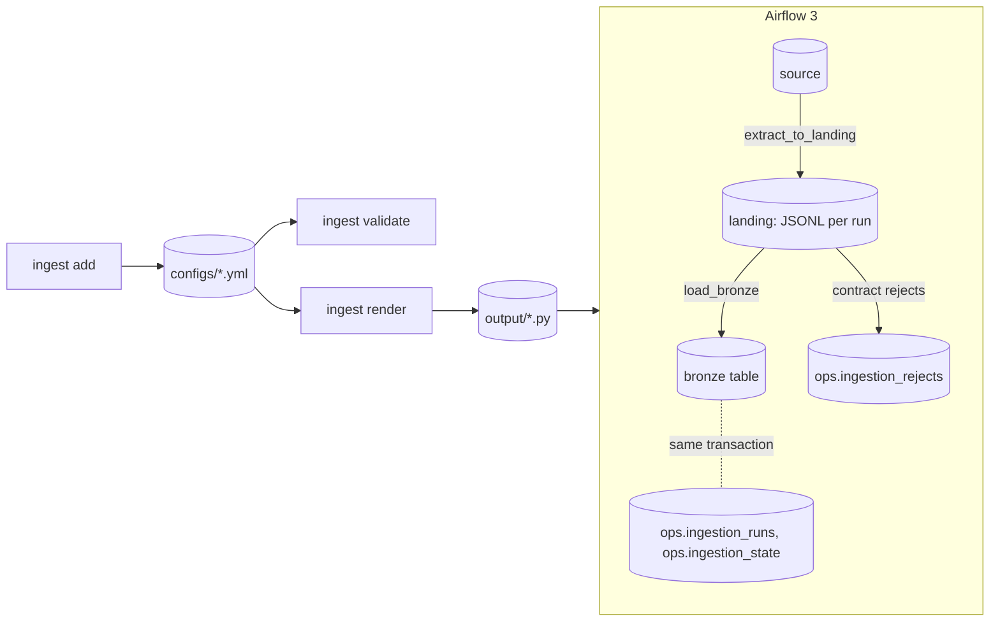

# ingestion-toolkit

> A command line tool that writes validated YAML or JSON ingestion configs, one per source table, and renders each into a self-contained Apache Airflow 3 DAG.


## What this demonstrates

- Config as a contract: frozen, typed Pydantic models with explicit validators. Every error names the file, the field and a fix.
- Three ingestion patterns as data: full scan, incremental (watermark) and change data capture (a sequence column or a SQL Server rowversion), with the write mode derived from the pattern, an optional column contract and a tolerated reject ratio.
- Deterministic output: the same command writes the same bytes, and a test rebuilds the files in `examples/` from the documented commands.
- Config to code: Jinja templates with no logic render one DAG file per config. Golden files pin the output, the generated code must parse and be `ruff format` clean, and CI imports the rendered DAGs with the DagBag of Airflow 3.3.2.
- Data engineering practice in the generated DAG: a landing layer (JSON Lines per run plus a manifest), a bronze table typed from a column contract, a rejects table, run metadata, and a watermark kept in the target database and advanced in the same transaction as the load, so a retry of the same run is idempotent. Merge loads keep the highest version per key, so replaying a window changes nothing.
- Property-based tests (Hypothesis) for naming, cron validation, the column spec and the model round trip, on top of CLI tests.
- A typed, src-layout package built with uv, checked with ruff and strict mypy.

The rendered DAGs run end to end against Postgres in the compose demo below, and CI runs that demo as a smoke test.

## How it works



`ingest init` lays out a project, `ingest add` builds a config from command line options, validates it and writes it. `ingest validate` checks files or directories and reports every problem it finds. `ingest render` turns each config into a DAG file. The CLI never imports Airflow. See [docs/generated-dags.md](docs/generated-dags.md) for what a rendered DAG does, layer by layer.

## Tech stack

Python 3.11+, Typer, Pydantic v2, PyYAML, Jinja2, uv, pytest, Hypothesis, ruff, mypy.

## Quickstart

```bash
uv sync
uv run ingest add rdbms fullscan \
  --source erp --database erp --schema sales --table orders --primary-key id \
  --columns "id:integer!,customer_id:integer,product_id:integer,quantity:integer!,total:numeric,order_date:date" \
  --max-reject-ratio 0.01
uv run ingest validate examples
```

The `add` command writes `configs/erp__orders__fullscan.yml`:

<!-- example:start -->
```yaml
version: 1
source:
  name: erp
  source_type: rdbms
  connection_id: erp
  database: erp
  schema_name: sales
extract:
  table: orders
  primary_key:
    - id
  pattern: fullscan
  columns:
    - name: id
      type: integer
      nullable: false
    - name: customer_id
      type: integer
      nullable: true
    - name: product_id
      type: integer
      nullable: true
    - name: quantity
      type: integer
      nullable: false
    - name: total
      type: numeric
      nullable: true
    - name: order_date
      type: date
      nullable: true
load:
  connection_id: warehouse
  target_schema: bronze
  target_table: erp__orders
  write_mode: overwrite
  max_reject_ratio: 0.01
landing:
  root: /opt/airflow/data/landing
schedule:
  cron: '@daily'
  start_date: 2026-01-01
  retries: 3
  retry_delay_minutes: 5
  tags: []
metadata:
  owner: data-engineering
```
<!-- example:end -->

An incremental config adds a watermark. `examples/postgres/erp__customers__incremental.yml` comes from:

```bash
uv run ingest add rdbms incremental \
  --source erp --database erp --schema sales --table customers --primary-key id \
  --columns "id:integer!,name:text,email:text,city:text,created_at:timestamp,updated_at:timestamp" \
  --watermark-column updated_at --watermark-type datetime
```

A CDC config reads a change feed ordered by a sequence column and merges it into bronze. `examples/postgres/erp__products__cdc.yml` comes from:

```bash
uv run ingest add rdbms cdc \
  --source erp --database erp --schema sales --table products --primary-key id \
  --columns "id:integer!,name:text,category:text,price:numeric,version_stamp:integer!" \
  --sequence-column version_stamp
```

Options for `rdbms cdc`: `--sequence-type integer|datetime`, `--change-table`, `--operation-column`, `--delete-values D,X` and `--merge-keys`. For SQL Server, a rowversion column replaces the sequence, and the schema defaults to dbo. `examples/mssql/erp_mssql__products__cdc.yml` comes from:

```bash
uv run ingest add mssql cdc \
  --source erp_mssql --database erp --table products --primary-key id \
  --columns "id:integer!,name:text,price:numeric,row_version:text!" \
  --rowversion-column row_version
```

What a source must provide, and the ordering and delete caveats, are in [docs/cdc-contract.md](docs/cdc-contract.md).

### Start a project

```bash
uv run ingest init my-ingestion
uv run ingest validate my-ingestion/configs
uv run ingest render my-ingestion/configs --output-dir my-ingestion/output
```

`ingest init [DIR]` writes `configs/erp__orders__fullscan.yml` (a commented starter that validates), an empty `output/` and a `.gitignore` that ignores it. It refuses to overwrite existing files without `--force`.

### Render DAGs

```bash
uv run ingest render examples/postgres examples/mssql --output-dir output
```

This writes one file per example, such as `output/erp__orders__fullscan.py` and `output/erp__products__cdc.py`. Put them in your Airflow `dags` folder, with connections `erp` (the source) and `warehouse` (the target PostgreSQL) defined. `--dry-run` lists the files without writing, and `--template-dir DIR` overrides built-in templates file by file. If any config is invalid nothing is written. The rendered incremental DAG reads like this (shortened):

```python
@task
def extract_to_landing() -> str:
    """Copy rows above the stored watermark into this run's landing partition."""
    run_id = get_current_context()["run_id"]
    ...
    with closing(PostgresHook(postgres_conn_id=TARGET_CONN_ID).get_conn()) as target:
        with target.cursor() as cur:
            state = _read_state(cur)
            _guard_order(cur, state, run_id)
        lower = _lower_bound(state, run_id)
        ...


with DAG(dag_id=DAG_ID, schedule=SCHEDULE, catchup=False, max_active_runs=1, ...) as dag:
    ensure_tables = SQLExecuteQueryOperator(task_id="ensure_tables", ...)
    ensure_tables >> extract_to_landing() >> load_bronze()
```

Add `--format json` for JSON, `--output-dir` to choose the folder and `--force` to overwrite an existing file. Run `uv run ingest add rdbms fullscan --help` for every option.

Errors go to stderr, one line each, followed by a summary:

```text
error: configs/erp__orders__fullscan.yml: load.max_reject_ratio: max_reject_ratio is 2.0, allowed 0 to 1. Fix: use a value from 0 to 1
0 valid, 1 invalid
```

Exit codes: 0 when everything is valid, 1 for an invalid config or a refused overwrite, 2 for a usage error.

## Demo

Needs Docker with Compose, `make` and `uv`.

```bash
make demo
```

This renders `examples/postgres` into `demo/dags`, starts Postgres 18 and Airflow 3.3.2 (the stock image, no Dockerfile), runs the three DAGs for the logical date 2026-01-01 and prints what landed. Airflow is at http://127.0.0.1:8080 (demo auth, no login). `make down` stops the stack and deletes its volumes.

What you see, layer by layer:

- Source: database `erp`, schema `sales`, read through the `erp_reader` role that can only SELECT there. `orders` has 1000 rows, one of them with a NULL `quantity`. `customers` has 200 rows with an `updated_at` column. `products` has 100 rows with a `version_stamp` that a trigger sets from a sequence on every insert and update.
- Landing: JSON Lines plus a manifest per run under `demo/data/landing/{source}/{table}/run_id=.../`.
- Bronze: `bronze.erp__orders` has 999 rows, because the NULL `quantity` breaks the column contract (`quantity:integer!`) and `max_reject_ratio: 0.01` tolerates one in a thousand. `bronze.erp__customers` has 200 rows, and `bronze.erp__products` has 100, merged by the CDC DAG.
- Ops: the rejected row is in `ops.ingestion_rejects` with its reason and payload, each run is a row in `ops.ingestion_runs`, and the customers watermark and the products sequence are in `ops.ingestion_state`.

`make demo` can be run again. `demo/run_dag.py` runs each DAG through `DAG.test` with the run id fixed by the logical date (`manual__2026-01-01T00:00:00+00:00`), so a second run is a re-run of the same Airflow run: the DAGs replace their own rows and the counts do not change. (`airflow dags test` would name every run after the current time.)

`make smoke` starts from an empty stack and asserts the whole scenario with `demo/smoke/*.sql`: the first run, the same run id executed a second time (counts, rejects and watermark unchanged, run executed again), a next day with no source change (the incremental and CDC runs extract 0 rows), and a source change (`demo/postgres/seed/mutate.sql`) followed by another day (1009 orders, 208 customers because append keeps history, and 102 products because the CDC merge applies 4 updates in place and adds 2). CI runs it in the `smoke` job.

Everything in the demo is synthetic and the passwords in `.env.example` are for the local stack only.

## Config reference

The file name must be `{source}__{table}__{pattern}` in lowercase, for example `erp__orders__fullscan.yml`. Unknown fields are rejected, and so are duplicate YAML keys. An optional section (`load`, `landing`, `schedule`, `metadata`) that is missing or null takes its defaults; to run a DAG only when triggered, set `schedule.cron: null` instead.

| Section | Field | Default | Notes |
| --- | --- | --- | --- |
| root | version | required | Must be 1 |
| source | name | required | Lowercase segment: letters, digits, single underscores |
| source | source_type | rdbms | rdbms or mssql |
| source | connection_id | the source name | Airflow connection id |
| source | database | required | Identifier |
| source | schema_name | public (dbo for mssql) | Identifier |
| extract | table | required | Identifier; lowercased it must be a valid segment |
| extract | primary_key | required | A name or a list, unique, at least one |
| extract | pattern | required | fullscan, incremental or cdc |
| extract | columns | none | Data contract: name, type, nullable. Without it the extract reads all columns |
| extract | watermark | none | Required for incremental, forbidden otherwise: column, type, initial_value |
| extract | cdc | none | Required for cdc, forbidden otherwise (see below) |
| cdc | mechanism | generic | generic or rowversion (rowversion needs source_type mssql) |
| cdc | sequence_column | required | Orders the changes; the rowversion column for rowversion |
| cdc | sequence_type | integer | integer or datetime; leave it out for rowversion |
| cdc | change_table | none | Table or view in the same schema to read instead of the table |
| cdc | operation_column | none | Column whose values mark deletes |
| cdc | delete_values | [D] | Non-empty when operation_column is set |
| load | connection_id | warehouse | Target connection id |
| load | target_schema | bronze | Identifier |
| load | target_table | source__table | At most 59 characters |
| load | write_mode | from the pattern | fullscan: overwrite (or append). incremental: append (or merge). cdc: merge |
| load | merge_keys | the primary key | Only with write_mode merge; at least one column, unique |
| load | max_reject_ratio | 0.0 | From 0 to 1 |
| landing | root | /opt/airflow/data/landing | Non-empty path |
| schedule | cron | @daily | null, a preset, or five cron fields |
| schedule | start_date | 2026-01-01 | A fixed default keeps files deterministic |
| schedule | retries | 3 | 0 to 10 |
| schedule | retry_delay_minutes | 5 | 1 to 1440 |
| schedule | tags | [] | Each 1 to 100 characters |
| metadata | owner | data-engineering | Non-empty |
| metadata | description | none | Free text |

Column types are integer, numeric, float, boolean, text, date, timestamp and timestamptz. Column names cannot start with `_ingest_` and cannot repeat.

With a column contract, the primary key and the watermark column must be listed in it. Primary key columns are stored as not null. A datetime watermark needs a timestamp, timestamptz or date column, and an integer watermark needs an integer column. The initial value must be an ISO datetime or an integer to match the watermark type. It is stored as text in one canonical form: an ISO datetime such as 2026-01-01T00:00:00, or an integer such as 5 (so 5, +05 and '5' are the same value). Columns and key names cannot start with `_ingest_`, including the primary key and the watermark column.

With `cdc`, the sequence column (and the operation column when set) must be in the contract: an integer sequence needs an integer column, a datetime one a timestamp, timestamptz or date column, and a rowversion a text column. Merge keys must be in the contract too. A merge target has a primary key on the merge keys, so the merge keys and the sequence column are stored as not null.

Presets for cron are @once, @hourly, @daily, @weekly, @monthly, @quarterly and @yearly. Five-field expressions accept ranges, steps, lists, and month and weekday names.

## Project structure

```text
src/ingestion_toolkit/
  cli/            main, add, init, validate, render and shared error output
  scaffold/       the starter config `ingest init` writes
  models/         enums, the frozen config models and the render contexts (task.py)
  renderer.py     Jinja environment, context builder, atomic writes
  sql.py          quoted identifiers and the SQL text of the rendered DAGs
  templates/      Jinja templates of the DAG file (no logic)
  config_io.py    read, validate and write configs (YAML loader rejects duplicate keys)
  columns.py      the --columns mini-language
  cron.py         schedule validator
  naming.py       identifier rules, DAG ids, bronze table names
  errors.py       error values and the one-line error format
examples/         postgres/ (three configs) and mssql/ (one), reproduced by tests/test_examples.py
compose.yaml      the demo stack; demo/ holds the seed data, smoke test and rendered DAGs
scripts/          check_dag_imports.py, the DagBag gate CI runs
tests/            unit, property-based, golden-file and CLI tests (tests/golden)
docs/             design decisions, the implementation plan, generated DAGs and the CDC contract
```

## Development

```bash
make install lint test
```

Without make: `uv sync`, `uv run ruff check`, `uv run ruff format --check`, `uv run mypy` and `uv run pytest`. `uv run pytest -m slow` runs the property test that renders hundreds of random configs. After changing a template, run `uv run pytest tests/test_golden.py --update-golden` and read the diff.

Airflow does not run on Windows. The DagBag check needs Linux (or WSL) and an environment with `apache-airflow[postgres]==3.3.2`; the `dag-import` job in `.github/workflows/ci.yml` shows the exact commands.

## License

MIT, see [LICENSE](LICENSE).
