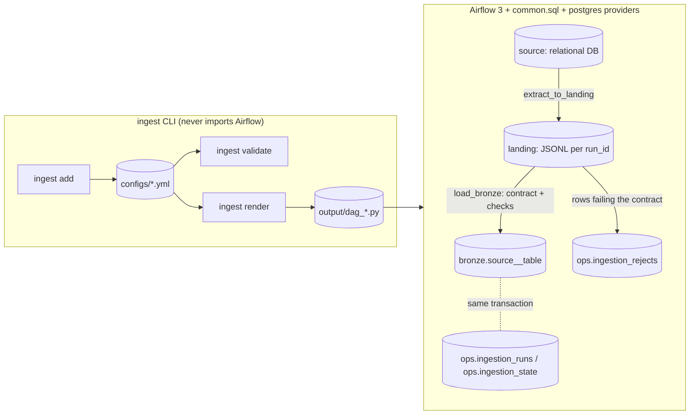

# Implementation plan

The blueprint the three phase PRs follow. Design decisions taken here are logged in
`docs/DECISIONS.md`. Versions were checked on 2026-10-25.

## 1. Overview and layers

`ingest` is a CLI that turns one YAML/JSON config per source table into one self-contained
Airflow 3 DAG file. The CLI never imports Airflow. A rendered DAG moves data through three named
layers:



- **source**: any connection whose hook is a `DbApiHook` (Postgres in the demo, SQL Server for
  the rowversion CDC mechanism).
- **landing**: one JSONL partition per Airflow run plus a `_manifest.json`, on the worker's
  filesystem.
- **bronze**: a PostgreSQL table per source table, typed from the config's `columns` contract
  (text columns without one), with `_ingest_run_id` and `_ingest_loaded_at`.
- **ops**: run metadata, rejects and watermark/CDC state in the target database.

Silver and gold are out of scope: they belong to a downstream tool such as dbt.

## 2. Package layout

```
pyproject.toml, uv.lock            packaging and tool config                              [PR1]
Makefile                           help install lint test test-fast [PR1]; render [PR2]; up down demo smoke [PR3]
README.md CHANGELOG.md LICENSE CLAUDE.md .gitignore                                       [PR1]
compose.yaml, .env.example         demo stack, compose project name ingestion-toolkit      [PR3]
docs/DECISIONS.md, REFACTOR_PLAN.md [PR1]; generated-dags.md [PR2]; cdc-contract.md [PR3]
examples/postgres/erp__orders__fullscan.yml, erp__customers__incremental.yml [PR1]; erp__products__cdc.yml [PR3]
examples/mssql/erp_mssql__products__cdc.yml                                               [PR3]
src/ingestion_toolkit/
  __init__.py      __version__ via importlib.metadata; __main__.py (python -m); py.typed
  errors.py        ConfigError / RenderError(path, loc, message, hint), format_error()
  naming.py        SEGMENT_RE, IDENT_RE, dag_id(), config_stem(), bronze_table_name()
  cron.py          is_valid_schedule(str | None) -> bool
  columns.py       parse_columns_spec() / format_columns_spec() for --columns
  config_io.py     discover(paths), read_config, read_configs (collects all errors), write_config;
                   a SafeLoader that rejects duplicate keys
  models/enums.py, models/config.py [PR1]; models/task.py [PR2]
  sql.py           quote_ident, qualified_name, select/where builders, PG type map, DDL        [PR2]
  renderer.py      build_dag_context(config, config_name) -> DagContext; Renderer            [PR2]
  templates/       section 5                                                                  [PR2, PR3]
  scaffold/erp__orders__fullscan.yml   commented starter config for `ingest init`             [PR3]
  cli/main.py add.py validate.py _report.py [PR1]; render.py [PR2]; init.py [PR3]
scripts/check_dag_imports.py       DagBag gate for CI                                         [PR2]
demo/postgres/initdb/00_init.sh, demo/postgres/seed/{erp.sql,mutate.sql}, demo/smoke.sh,
demo/smoke/{after_first,after_retry,after_mutation}.sql, demo/dags/.gitkeep, demo/data/.gitkeep  [PR3]
tests/                             section 7
.github/workflows/{ci,security,release}.yml, .github/dependabot.yml                           [PR1]
```

## 3. Config models

`models/config.py`. Every model is frozen with `extra="forbid"`.

```yaml
version: 1                       # Literal[1]
source:
  name: erp                      # SEGMENT
  source_type: rdbms             # rdbms | mssql
  connection_id: erp             # default = name -> AIRFLOW_CONN_ERP
  database: erp                  # required; rendered as "db"."schema"."table"
  schema_name: sales             # default: public (rdbms), dbo (mssql)
extract:
  table: orders                  # IDENT; DAG segment = table.lower(), must match SEGMENT
  primary_key: [id]              # str accepted, stored as list; >= 1 column, unique
  pattern: fullscan              # fullscan | incremental [PR1]; cdc [PR3]
  columns:                       # optional data contract; None = SELECT *, text bronze
    - {name: id, type: integer, nullable: false}
  watermark: {column: updated_at, type: datetime, initial_value: null}   # incremental only
  cdc: {mechanism: generic, sequence_column: version_stamp, sequence_type: integer,
        change_table: null, operation_column: null, delete_values: [D]}  # cdc only [PR3]
load:
  connection_id: warehouse       # target Postgres -> AIRFLOW_CONN_WAREHOUSE
  target_schema: bronze
  target_table: null             # default "{source}__{table_segment}"
  write_mode: null               # derived: fullscan -> overwrite, incremental -> append, cdc -> merge
  merge_keys: null               # [PR3] default = primary_key when merge
  max_reject_ratio: 0.0          # 0..1
landing: {root: /opt/airflow/data/landing}
schedule: {cron: "@daily", start_date: 2026-01-01, retries: 3, retry_delay_minutes: 5, tags: []}
metadata: {owner: data-engineering, description: null}
```

Column types: `integer` (bigint), `numeric`, `float` (double precision), `boolean`, `text`,
`date`, `timestamp`, `timestamptz`.

`start_date` defaults to 2026-01-01. With `catchup=False` a past date only marks when the
schedule begins, and a fixed default keeps generated files deterministic.

Validators. Each message names the field and ends with `Fix: ...`.

- `SEGMENT_RE = ^[a-z][a-z0-9]*(_[a-z0-9]+)*$` (no `__`, no leading or trailing `_`) for
  `source.name` and the lowercased table.
- `IDENT_RE = ^[A-Za-z_][A-Za-z0-9_]{0,62}$` for database, schema, table, columns, keys and
  watermark/sequence columns. Connection ids: `^[A-Za-z0-9_][A-Za-z0-9_.-]*$`.
- `len(target_table) <= 59`. Column names starting `_ingest_` are reserved; no duplicates.
- With `columns`: the primary key, merge keys and the watermark/sequence column must be in it,
  with compatible types (datetime: timestamp/timestamptz/date; integer: integer; string: text;
  rowversion: text). Primary-key columns are forced to not-null.
- `watermark` is required for incremental and forbidden otherwise; `cdc` likewise for cdc.
  `initial_value` must parse for its type (ISO datetime or int).
- Allowed write modes: fullscan {overwrite, append}; incremental {append, merge}; cdc {merge}.
- [PR3] rowversion requires `source_type: mssql`; `delete_values` must be non-empty when
  `operation_column` is set.
- `cron`: null, a preset (`@once @hourly @daily @weekly @monthly @quarterly @yearly`) or five
  fields with ranges, steps, lists and names checked. Pure validator, no croniter dependency.
- `retries` 0..10, `retry_delay_minutes` 1..1440, each tag 1..100 characters.

## 4. Rendered DAG design

Tasks, the same for every pattern: `ensure_tables` (SQLExecuteQueryOperator) >>
`extract_to_landing` (@task) >> `load_bronze` (@task). `catchup=False`, `max_active_runs=1`,
nothing runs at import time.

**Landing.** Files go to
`{root}/{source}/{table}/run_id={sanitized}/part-00000.jsonl` plus `_manifest.json`.
Sanitizing replaces anything outside `[A-Za-z0-9_.=-]` with `_`. The manifest holds run_id,
columns, row_count, watermark_from/to and extracted_at (UTC). Extract empties the partition
first, streams `fetchmany(10_000)` into a `.tmp` file, renames it, and writes the manifest last
as the commit marker. Serialization: datetime/date/time as isoformat, Decimal as str, bytes as
`"0x"` plus uppercase hex, UUID as str, `allow_nan=False`. Any other type fails the run and
names the column. JSONL keeps NULL apart from `''`, numbers apart from strings and names every
column, with the stdlib only.

`load_bronze` finds the partition from its own `run_id` (the XCom is for display only), so a
retry replays exactly the same input.

**Load transaction** (one connection, autocommit off):

1. `CREATE TABLE IF NOT EXISTS` bronze. Typed DDL comes from `columns`; without a contract the
   columns are text, named from the manifest. Every table gets `_ingest_run_id text NOT NULL`
   and `_ingest_loaded_at timestamptz NOT NULL`. Merge tables also get
   `_ingest_deleted boolean NOT NULL DEFAULT false` and a PK on `merge_keys`.
2. Drift check: manifest columns against `information_schema.columns`. A new or missing column
   fails with a hint.
3. Prepare by write mode. overwrite: `DELETE FROM bronze` (readers keep the old data until
   commit; TRUNCATE would lock them out). append: `DELETE WHERE _ingest_run_id = %s`.
   merge: nothing.
4. Row checks: not-null for primary-key and non-nullable columns, then a cast per type. Failing
   rows go to the rejects list with a reason; the rest are inserted in `executemany` batches.
5. Batch checks: duplicate primary keys within the run fail the run (not for merge);
   `rows_loaded + rows_rejected == manifest.row_count`;
   `rows_rejected / row_count <= max_reject_ratio`.
6. Replace this run's rejects, advance the state, upsert the runs row as `success`, COMMIT.
7. On a `QualityError`: roll back, write the rejects and a `failed` runs row in a separate
   transaction, raise `AirflowFailException` (data errors do not retry). Any other exception
   retries normally.

| Pattern | Extract SQL | Write mode | State |
|---|---|---|---|
| fullscan | `SELECT <cols or *> FROM "db"."schema"."table"` | overwrite or append | none |
| incremental | `... WHERE "wm" > {ph}`; no WHERE without a bound | append or merge [PR3] | max(wm) of extracted rows |
| cdc generic [PR3] | `... FROM change_table WHERE "seq" > {ph} ORDER BY "seq"` | merge | max(seq) |
| cdc rowversion [PR3] | `... WHERE "rv" > CONVERT(binary(8), {ph}, 1) AND "rv" < MIN_ACTIVE_ROWVERSION()` | merge | max as fixed-width hex |

- `{ph}` is the source hook's `placeholder`, filled at runtime, so each driver's paramstyle works.
- Lower bound: if `state.run_id` equals this run_id, use `previous_watermark` (a retry of the
  same run); otherwise `watermark`, then `initial_value`.
- Out-of-order guard: if this run_id already succeeded and the state belongs to a later run,
  extract raises `AirflowFailException` asking for a new run instead.
- State upsert: `previous_watermark = CASE WHEN s.run_id = EXCLUDED.run_id THEN
  s.previous_watermark ELSE s.watermark END`. An empty extract leaves the state alone.
- Merge: keep the highest sequence per key within the batch, then
  `INSERT ... ON CONFLICT (keys) DO UPDATE ... WHERE t.seq <= EXCLUDED.seq`. Delete operations
  set `_ingest_deleted = true`. CDC bronze is a current-state mirror; landing keeps the change
  history.

**`ops` tables** (created idempotently by `ensure_tables`):

- `ingestion_runs`: PK (dag_id, run_id); source, source_table, target_table, pattern,
  status (`extracted|success|failed`), watermark_from, watermark_to, rows_extracted,
  rows_loaded, rows_rejected, landing_path, started_at, extracted_at, finished_at
  (timestamptz, UTC), error.
- `ingestion_rejects`: PK (dag_id, run_id, row_number); reason, payload jsonb, rejected_at.
- `ingestion_state`: PK dag_id; watermark, watermark_type, previous_watermark, run_id,
  updated_at.

Imports in rendered files: `from airflow.sdk import DAG, BaseHook, get_current_context, task`,
`SQLExecuteQueryOperator` from `airflow.providers.common.sql.operators.sql`, `PostgresHook`
from `airflow.providers.postgres.hooks.postgres`. Every import is proven by the CI DagBag job,
which also fails on deprecation warnings raised from the DAG files.

## 5. Templates and renderer

```
templates/dag_base.py.j2              header, imports, includes, DAG block, wiring
templates/constants.py.j2             module constants (ids, SQL, contract) through the `py` filter
templates/helpers/landing.py.j2       partition, JSONL writer/reader, manifest
templates/helpers/contract.py.j2      casts, _validate_row, drift check, QualityError
templates/helpers/run_metadata.py.j2  OPS_DDL, runs upsert, rejects, _record_failure
templates/helpers/state.py.j2         read state, lower bound, guard, advance  (incremental, cdc)
templates/tasks/ensure_tables.py.j2
templates/tasks/extract/fullscan.py.j2 | windowed.py.j2 (incremental and cdc)
templates/tasks/load/overwrite.py.j2 | append.py.j2 | merge.py.j2 [PR3]   (prepare + insert)
templates/tasks/load_bronze.py.j2     the shared transaction body
```

- No logic in templates: the renderer picks `dag.extract_template`, `dag.load_template` and
  `dag.helper_templates`. Templates use only ``, `` over those lists and
  `{{ x | py }}`, where `py` is `repr`, so every literal is valid, safely quoted Python.
- Environment: `ChoiceLoader([FileSystemLoader(template_dir), PackageLoader("ingestion_toolkit",
  "templates")])`, `StrictUndefined`, `trim_blocks`, `lstrip_blocks`, `keep_trailing_newline`,
  `autoescape=False` (it renders Python). An override directory replaces any file by relative
  path; the rest falls back to the built-ins.
- Context (`models/task.py`, frozen): `DagContext` (dag_id, config_name, description, owner,
  schedule, start_date, retries, retry_delay_minutes, tags = sorted user tags plus source,
  pattern and `ingestion-toolkit`, source_conn_id, target_conn_id, landing_dir, extract, load,
  helper_templates); `ExtractTaskContext` (template, extract_sql, bound_column, bound_type,
  initial_value); `LoadTaskContext` (template, bronze_table, columns, pg_ddl, prepare_sql,
  insert_sql, primary_key, merge_keys, sequence_guard, operation_column, delete_values,
  max_reject_ratio). `build_dag_context` is pure; all SQL comes from `sql.py`.
- Render: template, `ast.parse` (a failure raises RenderError naming the template and the
  config), temp file plus `os.replace` to `{output}/{dag_id}.py`. Deterministic: no timestamp or
  version in the header. Bulk render is all-or-nothing: if any config is invalid, nothing is
  written.
- Golden files: `tests/conftest.py` adds `--update-golden` to rewrite `tests/golden/*.py`; CI
  never passes it. Goldens are excluded from E501 but stay under `ruff format --check`.

## 6. CLI

Errors go to stderr as `error: <path>: <loc>: <message>. Fix: <hint>`, one line each, then
`N valid, M invalid`. Exit codes: 0 ok, 1 invalid config or render failure, 2 usage error.
`no_args_is_help=True`, `add_completion=False`, `--version`.

| PR | Command | Options |
|---|---|---|
| 1 | `ingest add rdbms fullscan` | required `--source --database --table --primary-key` (comma-separated); `--schema --connection-id --target-connection-id --columns "id:integer!,total:numeric" --write-mode --max-reject-ratio --cron --start-date --tags --owner --description --output-dir configs --format yaml\|json --force` |
| 1 | `ingest add rdbms incremental` | the above plus required `--watermark-column`, `--watermark-type datetime`, `--initial-value` |
| 1 | `ingest validate [PATHS...]` | every file; the filename stem must be `{source}__{table}__{pattern}`; duplicate dag_ids |
| 2 | `ingest render [PATHS...]` | `--output-dir output --template-dir PATH --dry-run` |
| 3 | `ingest add rdbms cdc` | required `--sequence-column`; `--sequence-type integer\|datetime --change-table --operation-column --delete-values D --merge-keys` |
| 3 | `ingest add mssql cdc` | required `--rowversion-column`; `--merge-keys`; schema default dbo |
| 3 | `ingest init [DIR]` | `configs/` with a commented example, `output/`, `.gitignore`; `--force` |

`add` refuses to overwrite an existing file without `--force` (exit 1). `validate` and `render`
take positional paths (files or directories, default `configs/`).

## 7. Tests

pytest `-ra --strict-markers --strict-config`, timeout 60, a derandomized Hypothesis profile.

PR1: `test_naming` (dag_id round trip property; `__` rejected), `test_cron` (valid and
out-of-range properties), `test_columns` (format(parse(s)) == s), `test_models/test_config`
(every validator; `model_validate(model_dump(mode="json"))` round trip over
`tests/strategies.py`), `test_config_io` (round trip, duplicate keys, bad extension, YAML error
with path and line, all errors collected), `test_cli/test_add`, `test_validate`, `test_main`,
`test_examples` (the documented `ingest add` commands reproduce `examples/` byte for byte).

PR2: `test_sql`, `test_renderer` (context per pattern, override fallback, StrictUndefined and AST
failures as RenderError, all-or-nothing bulk, atomic write, dry run), `test_golden`, a `slow`
property (any valid config renders to code that parses, deterministically), `test_cli/test_render`,
`test_versions_in_sync` (the Airflow version in ci.yml equals the compose image tag), CI
`dag-import`.

PR3: CDC validators, merge keys default, add cdc and init in the CLI, goldens for generic and
rowversion, and the compose smoke:
run 1 at 2026-01-01 (orders 999 in bronze plus 1 reject, customers 200, products 100, three
`success` runs); the same logical date again (same run_id: counts and watermarks unchanged);
2026-01-02 (incremental and CDC extract 0 rows); `mutate.sql` then 2026-01-03 (orders 1009,
customers 208, products 102 with 4 updates applied).

## 8. CI and release

- `ci.yml`: push to main, pull_request, workflow_dispatch, weekly cron; `permissions: contents:
  read`; SHA-pinned actions with version comments, `persist-credentials: false`,
  `timeout-minutes`, setup-uv cache.
  - `lint` (3.11): `uv sync --locked`, `ruff check --output-format=github`,
    `ruff format --check`, `mypy` (strict, pydantic plugin).
  - `test` (needs lint): Python 3.11 and 3.14 on pushes and PRs; 3.11 to 3.14 on the weekly and
    manual runs.
  - `build` (needs lint): `uv build`, install the wheel in an isolated env, run `ingest
    --version`, `ingest add` and `ingest validate` in a temp dir. From PR2 also check the wheel
    lists `templates/dag_base.py.j2` and run `ingest render`.
  - [PR2] `dag-import` (needs test): render `examples/`, install
    `apache-airflow[postgres]==3.3.2` with the constraints file for Python 3.12, run
    `scripts/check_dag_imports.py` (DagBag from `airflow.dag_processing.dagbag`; fails on any
    import error, a DAG count different from the configs, or a warning raised from the DAG
    files).
  - [PR3] `smoke` (needs test): `make smoke`; compose logs on failure; always `make down`.
- `security.yml`: pip-audit over `uv export --frozen --all-groups --no-emit-project`; zizmor at
  medium severity; `lowest-direct` (`uv sync --resolution lowest-direct` on 3.11, then pytest).
- `dependabot.yml`: weekly, grouped, github-actions and uv. The Airflow version and image tag
  are bumped by hand; `test_versions_in_sync` catches drift.
- `release.yml`: on a `v*.*.*` tag, check the tag equals `uv version --short`, is on main and
  has a CHANGELOG section; `uv build`, upload, `twine check --strict`, install smoke; `pypi`
  (tag) and `testpypi` (manual) jobs with Trusted Publishing and attestations. Ready but not
  used until PyPI publishing is decided.

## 9. Demo stack (PR3)

Root `compose.yaml`, `name: ingestion-toolkit`.

- `postgres` (`postgres:18.6-alpine`): named volume `pgdata` (Postgres 18 images keep data under
  `/var/lib/postgresql`), `demo/postgres/initdb` on `/docker-entrypoint-initdb.d:ro`,
  `demo/postgres/seed` on `/seed:ro`, port `127.0.0.1:${POSTGRES_PORT:-5433}:5432`, healthcheck
  `pg_isready -h 127.0.0.1 -U postgres -d warehouse`. `00_init.sh` creates the `airflow`,
  `erp_reader` (SELECT on `erp.sales` only) and `warehouse_writer` roles, the three databases,
  and runs `/seed/erp.sql`. Deterministic seed: `sales.orders` 1000 rows (one with a NULL
  quantity, to show a reject; the demo config sets `max_reject_ratio: 0.01`),
  `sales.customers` 200 rows with `updated_at`, `sales.products` 100 rows with a
  `version_stamp bigint` set from a sequence by a trigger. `mutate.sql` adds 10 orders, updates
  5 and inserts 3 customers, updates 4 and inserts 2 products.
- `airflow` (`apache/airflow:3.3.2-python3.12`, command `standalone`): LocalExecutor, Postgres
  metadata DB, no example DAGs, simple auth manager with all users admin (demo only),
  connections `AIRFLOW_CONN_ERP` and `AIRFLOW_CONN_WAREHOUSE` as JSON env vars with passwords
  from `.env`, bind mounts `./demo/dags:/opt/airflow/dags:ro` and
  `./demo/data/landing:/opt/airflow/data/landing`, port `127.0.0.1:${AIRFLOW_PORT:-8080}:8080`,
  health on `/api/v2/monitor/health`. No Dockerfile: rendered DAGs run on the stock image.
- `make render-demo` renders `examples/postgres` into `demo/dags` on the host; `make up`,
  `make down` (`docker compose down -v`), `make demo`, `make smoke` (`demo/smoke.sh` runs
  each DAG through `demo/run_dag.py`, which calls `DAG.test` with `run_after` equal to the
  logical date, then the psql assertion files).

## 10. PR breakdown

**PR1, minimum shippable** (`feat/minimum-shippable`): packaging, hygiene, naming/cron/columns/
errors, models, config I/O, `ingest add rdbms fullscan|incremental`, `ingest validate`,
examples, README, workflows. Done: `make lint test` green; CI lint, test, build and security
green; `ingest --help` lists only `add` and `validate`; the README shows the `ingest add`
command and the YAML it writes, asserted by a test.

**PR2, render** (stacked on PR1): jinja2, `sql.py`, `models/task.py`, templates for fullscan
and incremental, renderer, `ingest render`, goldens, `scripts/check_dag_imports.py`, the
`dag-import` job, `docs/generated-dags.md`. Done: goldens pass; 0 import errors and 0 warnings
from DAG files; the wheel contains the templates; `ingest render examples --dry-run` exits 0.

**PR3, CDC, demo and init** (stacked on PR2): CDC models, merge load, `add rdbms cdc`,
`add mssql cdc`, `init`, compose stack, seed and smoke, `docs/cdc-contract.md`, the `smoke` job.
Done: `make smoke` green locally (WSL) and in CI, including the same-run_id retry; goldens
green; `ingest init` creates a valid project.

Decision 18 split PR3 in two: the compose demo, seed, smoke and `smoke` job shipped first
(GitHub PR #4), then CDC, merge loads, `add rdbms|mssql cdc`, `init` and
`docs/cdc-contract.md` (GitHub PR #5). The `[PR3]` tags above cover both. PR1 and PR2 are
GitHub PRs #1 and #3.

## 11. Risks and assumptions

- Proven only by running them (PR2/PR3): `BaseHook.get_connection(id).get_hook()` on the SDK
  connection; the non-deprecated import for `AirflowFailException`; `DbApiHook.placeholder`;
  how to re-run the same run_id (answered: `airflow dags test` in 3.3.2 names the run after the
  wall clock, so the demo calls `DAG.test(logical_date=d, run_after=d)`); providers bundled in the
  image; `standalone` with LocalExecutor on Postgres.
- Landing is a local filesystem: multi-worker executors need a shared volume or a template
  override using `ObjectStoragePath`.
- A strict `>` watermark misses rows committed late with an older value (incremental, generic
  CDC). Rowversion avoids it with `MIN_ACTIVE_ROWVERSION()`.
- Naive source timestamps compare in the source's time zone.
- The rowversion path has no SQL Server in the demo: it is covered by a golden file and the
  import check only.
