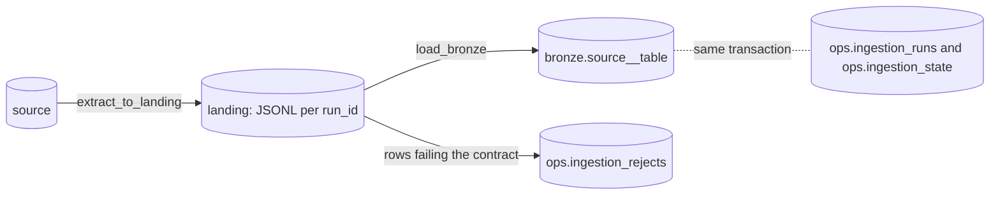

# Generated DAGs

`ingest render` writes one self-contained Airflow 3 DAG file per config, to
`{output-dir}/{dag_id}.py`. The file imports only Airflow and its public providers
(`airflow.sdk`, `common.sql`, `postgres`), has no dependency on this package, and does no work at
import time. The first line says which config produced it; change the config and render again
instead of editing the file. Output is deterministic: no timestamps, no versions.

## Layers



Every DAG has the same three tasks, `catchup=False` and `max_active_runs=1`:

```text
ensure_tables >> extract_to_landing >> load_bronze
```

### ensure_tables

A `SQLExecuteQueryOperator` on the target connection. In one transaction, behind an advisory lock
so DAGs started together do not race, it creates the bronze schema and the three `ops` tables if
they do not exist.

### extract_to_landing

Reads from the source through `BaseHook.get_connection(id).get_hook()`, so any connection whose
hook is a `DbApiHook` works. The partition is
`{landing.root}/{source}/{table}/run_id={run_id}/`, where characters outside `[A-Za-z0-9_.=-]`
in the run id become `_`.

- It empties the partition, streams `fetchmany(10_000)` into `part-00000.jsonl.tmp`, renames it,
  and writes `_manifest.json` last. A partition without a manifest was never committed.
- JSONL keeps NULL apart from the empty string and numbers apart from text. Datetimes and dates
  are ISO text, Decimal and UUID are text, bytes are `0x` plus uppercase hex. A float that is NaN
  or infinite, or any other type, fails the run and names the column.
- The manifest holds run_id, started_at, extracted_at (UTC), columns, row_count, watermark_from
  and watermark_to.
- It then upserts the run row with status `extracted`.

| Pattern | Extract SQL | Write mode | State |
| --- | --- | --- | --- |
| fullscan | `SELECT <columns or *> FROM "db"."schema"."table"` | overwrite or append | none |
| incremental | `... WHERE "wm" > <ph>`; no WHERE while there is no bound | append or merge | highest watermark extracted |
| cdc generic | `... FROM <change table or table> WHERE "seq" > <ph> ORDER BY "seq"` | merge | highest sequence extracted |
| cdc rowversion | `... WHERE "rv" > CONVERT(binary(8), <ph>, 1) AND "rv" < MIN_ACTIVE_ROWVERSION() ORDER BY "rv"` | merge | highest rowversion as `0x` plus 16 uppercase hex digits |

The placeholder is the source hook's own `placeholder`, so each driver's parameter style works.
With no bound yet (no state and no `initial_value`) the first run uses the same SELECT without the
lower bound; a rowversion keeps its upper bound there too. Incremental and cdc share one extract
template (`tasks/extract/windowed.py.j2`) and the state helpers. What a source must provide for
cdc is in [cdc-contract.md](cdc-contract.md).

### load_bronze

Finds the partition from its own run id (the extract's XCom is for display), so a retry replays
exactly the same input. One target transaction does all of this:

0. Stale-load check (see "State, idempotency and re-runs"): the load refuses an extract that a
   later run has already superseded.
1. `CREATE TABLE IF NOT EXISTS` bronze. With a `columns` contract the types come from it (integer
   is bigint, float is double precision); without one every column is text, named from the
   manifest. Every table gets `_ingest_run_id` and `_ingest_loaded_at`. Merge tables also get
   `_ingest_deleted boolean NOT NULL DEFAULT false` and a primary key on the merge keys; those
   keys and the sequence column are never null.
2. Drift check: the manifest columns against `information_schema.columns`. A new or missing
   column fails the run.
3. Prepare. Overwrite: `DELETE FROM bronze` inside the transaction, so readers keep the old data
   until commit. Append: `DELETE WHERE _ingest_run_id = <this run>`. Merge: nothing.
4. Row checks: not-null for primary-key and non-nullable columns, then one cast per column type.
   Text containing a NUL character (`\x00`) fails its cast, because PostgreSQL text cannot store
   it. Failing rows become rejects with a reason; the others are inserted in `executemany`
   batches (merge: an upsert, see below). A reject payload is the row as JSON with NUL written
   out as the four characters `\x00`, because `jsonb` refuses the NUL escape.
5. Batch checks: no duplicate primary key among this run's rows (not for merge); loaded plus
   rejected equals the manifest row count; rejected over total is at most `max_reject_ratio`.
6. Replace this run's rejects, advance the state (incremental), upsert the run row as `success`,
   commit.

A failed batch check is a data error: the load rolls back, the rejects and a `failed` run row are
written in a separate transaction, and the task raises `AirflowFailException`, so Airflow does not
retry it. So is a `psycopg2.DataError` raised while inserting a batch (numeric overflow, a date out
of range): the database refused a value, and retrying would refuse it again. The error message
keeps only the first line of the database message, never row values. Any other exception (a
network error, a lock) retries as the schedule says.

### Merge loads

`write_mode: merge` (always for cdc, optional for incremental) upserts each valid row:

```sql
INSERT INTO bronze.t AS t (...) VALUES (...)
ON CONFLICT (<merge keys>) DO UPDATE SET ... WHERE t.<seq> <= EXCLUDED.<seq>
```

The guard means an older version never replaces a newer one and the order of rows within a
batch does not matter: the highest sequence per key wins. Re-applying a window changes nothing.
The sequence is the cdc sequence column or the incremental watermark column, compared after a
cast (bigint, timestamptz, or text under the C collation for a rowversion). If the cdc config
names an `operation_column`, a row whose value is in `delete_values` is merged with
`_ingest_deleted = true` and stays in bronze. Bronze is a current-state mirror; the landing
partitions keep the change history.

## State, idempotency and re-runs

- Full scan overwrite is idempotent by construction. Append deletes the run's own rows first, so
  re-running a run never duplicates them. Merge is idempotent because an upsert of the same
  versions changes nothing.
- Incremental and cdc keep its watermark in `ops.ingestion_state`, advanced in the same transaction as
  the bronze write. The lower bound is `previous_watermark` when the state belongs to the same run
  id (a retry re-reads its own window), otherwise `watermark`, otherwise `initial_value`.
  The state upsert keeps `previous_watermark` when the run id repeats and sets it to the old
  watermark when a new run arrives.
- An extract with no rows leaves the state alone.
- Out-of-order guard: re-running a run that already moved the watermark, after a later run has
  moved it again, fails with a hint to trigger a new run, because its old window is gone.
- Stale-load guard, for clearing only `load_bronze` of an older run after a later run succeeded.
  Incremental and cdc: the load locks the state row (`FOR UPDATE`) and requires the manifest's
  `watermark_from` to equal the lower bound the state now gives this run; otherwise loading would
  duplicate the later run's rows and move the watermark back. Full scan: the load refuses when
  another run already loaded a snapshot extracted later. Both fail without retry and without
  touching the run rows, with a hint to clear the whole DAG run so the extract runs again.
- Watermark and initial values are stored as text. An integer watermark is bigint in bronze, so
  the config rejects initial values beyond the bigint range.

## ops tables

Created by `ensure_tables`, in the target database.

`ops.ingestion_runs`, primary key (dag_id, run_id):

| Column | Type | Meaning |
| --- | --- | --- |
| dag_id, run_id | text | the DAG and the Airflow run |
| source, source_table, target_table, pattern | text | what was loaded |
| status | text | extracted, success or failed |
| watermark_from, watermark_to | text | the window of an incremental run |
| rows_extracted, rows_loaded, rows_rejected | bigint | counts |
| landing_path | text | the partition folder |
| started_at, extracted_at, finished_at | timestamptz | UTC |
| error | text | the failure message |

`ops.ingestion_rejects`, primary key (dag_id, run_id, row_number): reason text, payload jsonb (the
landing line), rejected_at timestamptz.

`ops.ingestion_state`, primary key dag_id: watermark, watermark_type, previous_watermark, run_id,
updated_at. Used by incremental and cdc; for a rowversion the watermark is fixed-width hex text.

## Customizing

`ingest render --template-dir DIR` puts `DIR` ahead of the built-in templates. A file in `DIR`
replaces the built-in one with the same relative path (for example `tasks/load_bronze.py.j2`);
everything else falls back. Templates hold no logic: they use `include`, `for` and the `py`
filter, which writes a value as a Python literal. The renderer chooses which templates to include.

## Limitations

- Landing is the worker's local filesystem. With more than one worker, mount a shared volume or
  override the landing helper to use object storage.
- A strict `>` watermark misses rows committed late with an older value (incremental and
  generic cdc). Rowversion avoids it with `MIN_ACTIVE_ROWVERSION()`. See
  [cdc-contract.md](cdc-contract.md).
- The rowversion path has no SQL Server in the demo: a golden file and the import check cover it.
- Naive source timestamps compare in the source's time zone.
- The extract streams in batches of 10,000, but some drivers (psycopg2's default cursor) buffer the
  whole result client-side first.
- Rejected rows are held in memory until the load ends.
- Run ids that differ only in characters outside `[A-Za-z0-9_.=-]` share a partition.
- The source hook must be a `DbApiHook`. The target is PostgreSQL.
- Hard deletes in the source are invisible to cdc unless the change feed records them.
